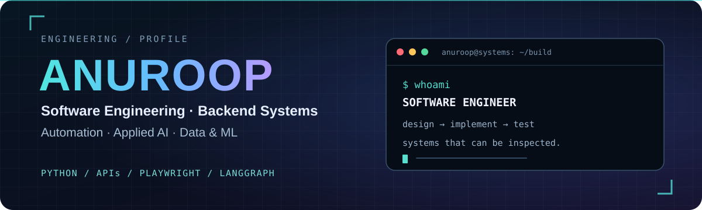

  

  
  
  

2026 **Electronics and Communication Engineering graduate** building backend software, automation systems, and applied-AI applications. I like engineering problems where correctness, reliability, and practical usefulness matter.

## `> whoami --verbose`

- **Focus:** Backend engineering · Automation · Applied AI
- **Build:** APIs, workflow systems, retrieval pipelines, data tools, and computer-vision applications
- **Approach:** Understand the behavior, make a reviewable change, test the result, document what is verified

## Featured builds

| Project | What it does |
|---|---|
| **[01 · Multi-Source Agentic RAG](https://github.com/anuroop258/multi-source-agentic-rag)** LangGraph · ChromaDB · BM25 · RRF · Cross-Encoder · Groq | Research assistant for uploaded documents and public-web sources, with hybrid retrieval, reranking, tool workflows, and conversation memory. The local Python stack and hosted Cloudflare Pages adapter are documented separately. [Live deployed demo](https://7b3ce3ac.multi-source-agentic-rag.pages.dev/) |
| **[02 · Autonomous Career Agent](https://github.com/anuroop258/autonomous-career-agent-cloud)** Python · Playwright · FastAPI · React · TypeScript | Multi-portal job workflow platform with JD screening, resume tailoring, application tracking, and human-reviewed actions. [Live website](https://autonomous-career-agent-cloud.pages.dev/#/) |
| **[03 · DroneVision](https://github.com/anuroop258/Dronevision)** ResNet-34 · U-Net · SSIM · Computer Vision | Aerial road segmentation and construction-change analysis. Evaluation figures and methodology are documented in the project repository. |
| **[04 · Retail Sales Analytics](https://github.com/anuroop258/Retail-Sales-Analytics)** Python · Pandas · NumPy · SQL · Streamlit · Plotly | Analytics pipeline and dashboard over 15,000 synthetic retail transactions, with reusable KPI logic and tests. |

## Stack

  

**Backend & APIs:** FastAPI · Flask · REST APIs  
**AI & retrieval:** LangGraph · LangChain · RAG · FAISS · ChromaDB · BM25 · Sentence Transformers  
**Automation & data:** Playwright · Pandas · NumPy · OpenCV · Matplotlib  
**Cloud & delivery:** GitHub Actions · Docker · Cloudflare Pages · Cloudflare D1

## Currently focused

Going deeper into backend engineering and established codebases: API correctness, concurrency, data integrity, test infrastructure, and maintainable developer tooling. Also pursuing meaningful upstream open-source contributions through reproducible issues, focused fixes, regression tests, and maintainer review.

## Background

**Vasavi College of Engineering** · Electronics and Communication Engineering · 2022–2026  
**Hyderabad, India** · Open to software engineering opportunities

---

  <a href="https://github.com/anuroop258?tab=repositories">Explore my repositories</a> &nbsp;·&nbsp;
  <a href="https://7b3ce3ac.multi-source-agentic-rag.pages.dev/">Try the Multi-Source RAG demo</a> &nbsp;·&nbsp;
  <a href="https://autonomous-career-agent-cloud.pages.dev/#/">Try the Career Agent</a>

<em>Build it. Measure it. Test it. Make the evidence easy to inspect.</em>

